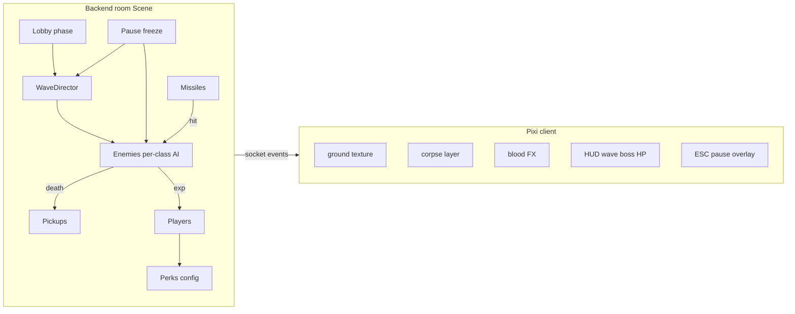

# Wave-арена на структуре master

База: ветка **`master`** (`components/Scene`, `Players`, `Enemies`, `Missiles`, rooms). Логику из `backend/World.ts` ветки `open-world` **не переносим** — только ассеты, [`backend/configs/Perks.ts`](backend/configs/Perks.ts) и нужные куски конфигов оружия/врагов.

## Жёсткие решения

- Режим: **PvE wave-арена в комнате** + **лобби** (`phase: lobby | playing`): ready / хост / «Поехали». В уже идущую игру войти нельзя.
- Стартовое оружие: **Pistol**.
- Дроп оружия (5 шт.): **Pistol, SMG, Rifle, Shotgun, Sniper**.
- Тиры: **green / yellow / red / boss**. У каждого типа врага **свой класс** в [`backend/components/Enemies/`](backend/components/Enemies/) (не один общий `Zombie`).
- Размер комнаты: [`backend/configs/Scene.ts`](backend/configs/Scene.ts) — **1400×1400**.
- Препятствия: **не делаем**.
- Трупы и кровь: **клиент** (сервер шлёт hit/death + `dir`).
- **Геометрия:** два rect на враге — `bulletHit` и `playerTouch`. Outlines хитбоксов не рисовать.

## Актуальный баланс волн ([`backend/configs/Waves.ts`](backend/configs/Waves.ts))

| Параметр | Значение |
|----------|----------|
| Длительность волны 1 | **20 с** |
| Каждая следующая | **+10 с** (30, 40, 50…) |
| Численность | `× (duration / 60с)` от reference-состава → волна 1 ≈ **⅓** старого count |
| Возраст волны | дополнительно **+10%** монстров за каждую волну после первой |
| Каждая **5-я** волна | **босс**: чёрный `Boss` (~2800 HP база × mul) + немного мелочи |
| Пауза между волнами | ~4.5 с + баннер `waveStarted` (`announcing`, `isBoss`) |

Сложность статов: HP/damage/speed mul по волне (`hpMulPerWave` и т.д.), speed cap ~2.2. Спавн кольцом от центра.

## Движение монстров (разный AI)

Общая база: [`ChaseEnemy.ts`](backend/components/Enemies/ChaseEnemy.ts) (`tickMove` / `commitMove`). Фабрика: [`createEnemy.ts`](backend/components/Enemies/createEnemy.ts).

| Класс | Поведение |
|-------|-----------|
| Zombie | прямой chase + лёгкий фланг |
| Crawler | зигзаг к игроку |
| Runner | рывок → пауза |
| Hound | дуга вокруг, сжимает кольцо |
| Spitter | держит дистанцию / стрейф |
| Bloater | медленно прёт, иногда стоит |
| Screamer | хаотичные рывки к цели |
| **Spider** | **только круг вокруг спавна, на игрока не идёт** |
| Soldier | подошёл → стрейф |
| Stalker | замирает → рывок |
| Brute | редко меняет курс (таран) |
| Behemoth | тяжёлая поступь с покачиванием |
| Boss | спираль к игроку |
| OrbitSpider | sandbox orbit (не арена) |

Дальше: уникальные атаки (плевок Spitter и т.п.) — по мере надобности, в файле класса.

## Решения из playtest (зафиксировать)

### Оружие и патроны
- Обойма конечная, R + авто при 0; запас бесконечный. HUD: `Pistol: 8/12`.
- Дроп: автоподбор ходьбой; TTL ~12 с.
- Курсор: только кольцо разброса у мыши.
- **Пистолет:** `spreadRecovery` понижен (~0.1), чтобы при **зажатии LKM** разброс **рос** (раньше recovery съедал increment между выстрелами).

### Волны и UI
- Угол: `ВОЛНА N` / на боссе `БОСС · ВОЛНА N`; центр — баннер (для босса «БОСС / ВОЛНА N»).
- Перки: карточки **внизу**; бой не на паузе от перков.
- Фон: тайловый ground.

### Пауза ESC (серверная)
- Esc / «Продолжить» → `togglePause` → `gamePaused`.
- На паузе: стоп AI врагов, заморозка таймеров WaveDirector (between + spawn), skip `Scene.update`, блок move/shoot/reload/pickup на сокете; клиент не интерполирует врагов/пули.
- Не путать с паузой перк-офера.

### Смерть / рестарт
- 0 живых → `wipeIfNoSurvivors` → `gameOver` + `sceneReset`.
- «Начать заново» → `PUT .../new-game` → снова **лобби**.
- Spawn protection ~3 с; clamp в границы карты.

### Перки (только PvE)
- Без PvP/open-world карточек. Fast×10 / TestMode — удалены.

### Frontend SSR
- Room id в UI из `useParams()`, не `getRoomId()` с `window` (иначе hydration mismatch). `getRoomId()` остаётся для Pixi/socket после mount.

## Геометрия коллизий (обязательно сохранить)

[`Scene.ts`](backend/components/Scene.ts) + [`geometry.ts`](backend/utils/geometry.ts):

- Пуля → `bulletHit` rect (`checkLineRectangleCollision`).
- Касание → `playerTouch` rect (`checkCircleRotatedRectangleCollision`).
- Не сливать в один бокс; не circles для врага.
- `hitFx` — точка с bullet-rect.

## Структура backend (как есть)

**Scene** — lobby/playing, pause, WaveDirector, game loop 20 ms, wipe/newGame, `getScene` (+ `paused`).

**Enemies/** — `BaseEnemy`, `ChaseEnemy`, по файлу на тип, `createEnemy` / `spawnTier`.

**WaveDirector** — announce → spawn по duration; pause/resume с remaining ms; boss wave composition.

**Players / Weapon / Missiles / Pickups** — как раньше (5 оружий, pellets/pierce, автоpickup).

**Socket/API** — `playerReady`, `startGame`, `togglePause`, `pickPerk`, `gamePaused`, `lobbyUpdated`, `gameStarted`, …

## Frontend (как есть)

- Слои: ground → corpses → entities → FX.
- HUD: волна/босс, HP, ammo, баннер.
- React overlays: лобби, пауза, смерть, перки снизу.
- Курсор: ring разброса.

## Проверка в браузере

1. Backend `:7789`, frontend `:7790`.
2. Лобби → старт → волны 1–5 (на 5-й босс): AI различимы, трупы/кровь/дроп/перки.
3. Esc: монстры и таймер волны реально стоят; resume продолжает спавн.
4. Зажать ЛКМ с пистолетом — кольцо разброса растёт.
5. Два клиента в одной комнате (общий прогресс / общая пауза).

## Дальше (не блокирует текущий билд)

1. Уникальные атаки у части монстров (Spitter ranged и т.д.).
2. Тюнинг boss HP / adds / длительности поздних волн.
3. Починить frontend eslint (`eslint.config.mjs` vs ESLint 8 — `eslint/config` не резолвится); backend eslint: 0 errors, остаются старые warnings (`any` / destructure в `toJSON`).
4. Playtest баланса «сессия ощущается играбельной».

## Изменения владельца 2026-11-09 (актуальнее разделов выше)

- Владелец: управление и HP/stamina сделать как в open-world «Зомбиках», **еду не добавлять**; дать мобильную версию, merge пушек, конечное прохождение и больше экшена.
- Управление: ПК — WASD, Shift sprint, Space dash, ПКМ точный прицел, ЛКМ огонь, E подбор, R перезарядка, I/Tab рюкзак. Телефон — динамический левый стик движения и правый стик прицела/огня + кнопки «Взять», R, «Рюкзак», «Рывок», «Бег».
- Stamina серверная: 100; sprint ×1.55, расход 23/с; regen 19/с после 550 мс; dash 145 px, цена 30, cooldown 1.5 с. Сервер ограничивает скачок позиции клиента.
- Инвентарь: 8 слотов. Дроп **не автоподбирается**, E/«Взять» кладёт его в свободный слот. Одинаковые `weaponId + level` объединяются до V; каждый уровень даёт +30% damage, +6% fire rate и +12% clip. Пушку можно экипировать, переставить или выбросить; последнюю выбросить нельзя. Дроп TTL 25 с, boss гарантирует II уровень.
- Матч конечный: 10 волн, боссы 5/10, после 10-й `phase=won` + `gameWon`. После каждой зачистки: 18% HP (минимум 12), stamina и магазин. Новая длительность: 18 с +4 с/волна, count age +6%/волна.
- Экшен: combo держится 3.5 с, даёт до +50% EXP; каждая 5-я быстрая смерть врага лечит 4 HP и возвращает 12 stamina. HUD показывает combo.
- Автопроверка `backend/tests/full-playthrough.js` с `ARENA_TIME_SCALE=0.002`: прошла все волны 1–10 до `gameWon`, проверяет merge, drop, sprint/stamina, dash, уровни/perks/combo. Последний прогон: ok, level 44 (зависит от случайных perks).
- Browser E2E 2026-11-09 00:35 МСК: desktop sprint/dash/inventory; mobile 844×390 — пять кнопок, реальное движение левым touch-stick, прицел+стрельба правым, dash, рюкзак помещается; console/page errors 0. Production build обоих компонентов и audit `0 vulnerabilities` прошли.
- Сервер Каркаде пока остаётся на `eee980d`; изменения локальные поверх `72fc6cf`. Откат до коммита/деплоя — `git restore` текущего diff; открыто: commit/push, серверный бэкап, deploy и публичный E2E.

### Релиз

- 2026-11-09 00:50 МСК — gameplay/UI выпущены на `https://game.lpt-group.ru/wave-arena`: код `ce4ce3e`, следующий infra-fix `df7a5d3` считает штатный SIGTERM Next успешной остановкой. Production `.release=df7a5d3`.
- Публичный E2E desktop/mobile и production full-playthrough 1–10 прошли; каталог game, Microwar, Zombies, Wave Arena и API отдают 200; backend/frontend/nginx active, рестартов 0.
- Бэкап прежнего `eee980d`: `/var/backups/lpt-wave-arena/upgrade-20261108T213907Z-ce4ce3e/` (188 МБ, SHA256 проверена). Временная распакованная копия старого приложения после проверки удалена.
- Открыто только эмпирическое уточнение баланса по живой игре; технических блокеров нет.

### Hotfix движения

- Владелец сообщил, что после любого движения игрока отбрасывает назад, в том числе при двух игроках.
- Причина: `playerStats` (stamina/патроны/exp) приходил чаще сетевого движения и применял к локальному `Player` запаздывающие `pageX/pageY`. Следующий кадр начинался со старой точки.
- Исправление: локальный transform не обновляется обычным stats/scene update; сервер задаёт его только при первичной загрузке и `sceneReset`. Для remote-player transform остаётся серверным. Сервер сохраняет sprint/aim state и clamp по границам, но не применяет временной speed-clamp к клиентским координатам.
- Чужой `e8fc3ad` с тем же направлением исправления был принудительно запушен поверх remote от базы `72fc6cf`; история объединяется merge-коммитом, не force-push, чтобы сохранить и его, и gameplay `ce4ce3e`.
- Regression: 2 Chromium-клиента одновременно Shift+W+стрельба, 30 серверных выборок + перехват исходящих `playerMoved`. До фикса production: 7 обратных скачков 4,27–22,06 px. После фикса: оба прошли 362–367 px, 45–46 кадров, обратных скачков 0, ошибок браузера 0.
- Merge без потери обеих линий истории: `789c8a7`, обычный fast-forward push в `ai-slop`, без force. Production Каркаде переключён на `789c8a7` 2026-11-09 12:26 МСК.
- Публичный regression после deploy: два игрока одновременно бежали и стреляли, прошли 694,4/847,7 px; по 30 серверным выборкам и 65/63 исходящим кадрам обратных скачков 0. Повторно прошли desktop/mobile E2E и production full-playthrough волн 1–10.
- Бэкап прежнего production `31d692e`: `/var/backups/lpt-wave-arena/movement-hotfix-20261109T092323Z-789c8a7/` (204 МБ, SHA256 проверена). Временная распакованная копия удалена; технических открытых пунктов по hotfix нет.

### Управление и HUD, 2026-11-19 22:26 МСК

- Запрос владельца: Tab не останавливает движение, удобное управление тачпадом, HP/EXP как во второй игре, прозрачный инвентарь.
- Рюкзак больше не блокирует ходьбу/прицел/стрельбу; `contextmenu` сохраняет зажатые клавиши. Потеря фокуса по-прежнему сбрасывает ввод. Стрелки задают направление прицела, F стреляет одновременно с WASD; мышь и touch-stick сохранены. Если ОС отключает тачпад при печати, об этом есть подсказка в меню; системные настройки игра не меняет.
- HP и EXP отображаются полосами с цифрами, рядом значок уровня; порог EXP приходит с сервера, поэтому прогресс корректен после повышения уровня. Выносливость сохранена, еды нет. Панель рюкзака и слоты полупрозрачны (0,48/0,45).
- Backend/frontend build прошли; full-playthrough 1–10 до победы; `frontend/tests/controls.cjs` проверяет сохранение движения при Tab/инвентарных кликах/ПКМ, клавиатурный прицел+огонь, отпускание клавиш/blur, HP/EXP и прозрачность в desktop/mobile-layout. Запуск: `NODE_PATH=<путь к node_modules с playwright> node frontend/tests/controls.cjs`, адреса задаются `WAVE_FRONT`/`WAVE_BACK`.
- До deploy production остаётся `789c8a7`; откат локальных изменений — обратный diff к `82a3a8a`. Открыто: commit/push и deploy с резервной копией, публичная проверка.
- 2026-11-19 22:33 МСК — изменения закоммичены/запушены как `2bd57b3` и выложены на Каркаде, `.release=2bd57b3`. Публичный UI-regression desktop/mobile-layout прошёл; backend/frontend/nginx active, рестартов 0, HTTP 200. Из-за локального DNS-сбоя публичный HTTPS проверен с привязкой известного IP сервера, без изменения DNS. Полный бэкап предыдущего `789c8a7`: `/var/backups/lpt-wave-arena/ui-20261119T192825Z-2bd57b3/`, 204 МБ, SHA256 проверена. Откат: остановить frontend/backend, распаковать оттуда `lpt-wave-arena-789c8a7.tgz` в `/opt` с заменой приложения, запустить службы. Для физического тачпада при системной блокировке во время печати требуется отключить соответствующую настройку ОС; игровое клавиатурное управление не зависит от неё.

### Панель оружия, 2026-11-20

- По запросу владельца добавлен `WeaponHud` в стиле open-world игры: зелёно-тёмная полупрозрачная панель справа сверху, существующая иконка текущей пушки, русское название, уровень I–V, патроны/ёмкость, полоса магазина, предупреждение о малом боезапасе и реальная перезарядка. Запас обозначен ∞ — механика арены остаётся с бесконечным запасом. Дублирующая Pixi-строка убрана, combo сохранён; мобильная кнопка рюкзака и wave-label разведены с панелью.
- App теперь обновляет React weapon-state по server `playersReloadStarted/Finished` даже без движения/stamina-обновлений; patch касается HUD/inventory, позицию игрока не меняет.
- `frontend/tests/weapon-hud.cjs`: desktop, mobile landscape/portrait, реальная стрельба и R без движения, 5 иконок, патроны после reload, отсутствие перекрытия HP/рюкзака, открытие/закрытие рюкзака — OK. Скриншоты просмотрены. Прежний `controls.cjs` также прошёл desktop/mobile (Tab не останавливает движение, keyboard aim/fire, HP/EXP, прозрачность).
- Backend не меняется; план frontend-only release без остановки матчей. Серверный бэкап/откат и итог деплоя — в `MOZG/agent_karkade.md`.
- 2026-11-20 09:57 МСК — выложен frontend-only `3983215` (HUD `51fb785` + оптимизация Pixi TextStyle). Production TypeScript/build прошли, публичный HUD E2E — desktop и обе ориентации телефона, JS errors 0. Backend PID до/после совпал, матчи не перезапускались. Актуальный клиент до замены сохранён и проверен SHA256; точный путь и процедура frontend-only отката — в тематическом журнале MOZG. Технических открытых пунктов по панели нет.

### Возрождение, монеты и магазин, 2026-11-21

- Погибшие возвращаются после зачистки волны только при живом союзнике, в том числе перед финальной победой. Сохраняются уровень, EXP, перки, выбранное оружие/инвентарь; HP/stamina/магазин восстанавливаются, даётся spawn protection. Если погибли все, revive нет. Новый матч по-прежнему сбрасывает боевой прогресс, кошелёк остаётся.
- Монеты за повышение: уровни 2–5 по 1, 6–10 по 2, 11+ по 3; стартовый уровень не награждается. Server ProfileStore проверяет цены/владение и повторный runId/уровень, пишет атомарно mode 600. Состояние хранится по PROFILE_DB_PATH вне релизов, не в Git. Профиль привязан к случайному браузерному ключу, в базе только его hash; между устройствами пока не синхронизируется. Ключи никогда не логируются. Один профиль — один активный игровой socket; магазин доступен из меню и после победы/поражения.
- 4 новых косметических скина: Алый рейдер (15), Север (35), Радиолог (65), Призрак (100). Built-in image_gen, настоящие alpha PNG и полный набор промптов — `frontend/public/img/skins/README.md`. Рендерер создаёт небольшие кэшируемые игровые walk-кадры. Скины не меняют характеристики; каталог поддерживает будущие типы товаров, сейчас продаются только скины.
- Исправлены lifecycle после смерти/магазина: снимаются старые HUD/socket handlers, возвращается Control, общие textures не уничтожаются при навигации, пустой room удаляется без минутной блокировки, host переназначается при выходе. Мёртвый враг из кэша не атакует после зачистки.
- Проверки: backend build/TS (28 прежних warnings), economy-revive.js (пороги/ledger/покупки/persistence/revive/final wave/no-survivor), полный прогон волн 1–10; shop-revive.cjs (2 клиента, mobile, 3 revive, покупка/надевание/skinId, магазин после wipe, возврат в тот же room, persistence после рестарта сервера, подделка price/balance отклонена). Готовые монеты создаются только локальному тестовому профилю, fixture control слушает только loopback и не входит в prod app.js.
- До deploy production `3983215`; требуется backup и backend restart. Доступы, точные пути server backup/откат и результат deploy — только в тематическом журнале MOZG.
