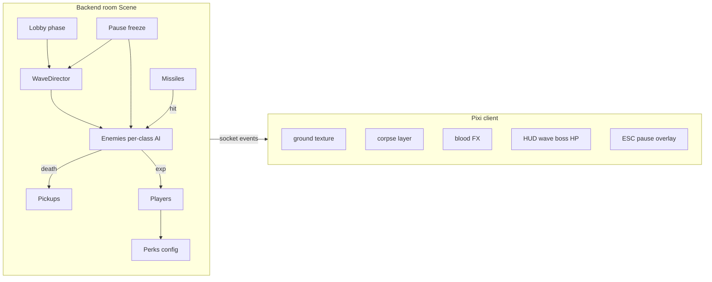

# Wave-арена на структуре master

База: ветка **`master`** (`components/Scene`, `Players`, `Enemies`, `Missiles`, rooms). Логику из `backend/World.ts` ветки `open-world` **не переносим** — только ассеты, [`backend/configs/Perks.ts`](backend/configs/Perks.ts) и нужные куски конфигов оружия/врагов.

## Жёсткие решения

- Режим: **PvE wave-арена в комнате** + **лобби** (`phase: lobby | playing`): ready / хост / «Поехали». В уже идущую игру войти нельзя.
- Стартовое оружие: **Pistol**.
- Дроп оружия (5 шт.): **Pistol, SMG, Rifle, Shotgun, Sniper**.
- Тиры: **green / yellow / red / boss**. У каждого типа врага **свой класс** в [`backend/components/Enemies/`](backend/components/Enemies/) (не один общий `Zombie`).
- Размер комнаты: [`backend/configs/Scene.ts`](backend/configs/Scene.ts) — **1400×1400**.
- Препятствия: **не делаем**.
- Трупы и кровь: **клиент** (сервер шлёт hit/death + `dir`).
- **Геометрия:** два rect на враге — `bulletHit` и `playerTouch`. Outlines хитбоксов не рисовать.

## Актуальный баланс волн ([`backend/configs/Waves.ts`](backend/configs/Waves.ts))

| Параметр | Значение |
|----------|----------|
| Длительность волны 1 | **20 с** |
| Каждая следующая | **+10 с** (30, 40, 50…) |
| Численность | `× (duration / 60с)` от reference-состава → волна 1 ≈ **⅓** старого count |
| Возраст волны | дополнительно **+10%** монстров за каждую волну после первой |
| Каждая **5-я** волна | **босс**: чёрный `Boss` (~2800 HP база × mul) + немного мелочи |
| Пауза между волнами | ~4.5 с + баннер `waveStarted` (`announcing`, `isBoss`) |

Сложность статов: HP/damage/speed mul по волне (`hpMulPerWave` и т.д.), speed cap ~2.2. Спавн кольцом от центра.

## Движение монстров (разный AI)

Общая база: [`ChaseEnemy.ts`](backend/components/Enemies/ChaseEnemy.ts) (`tickMove` / `commitMove`). Фабрика: [`createEnemy.ts`](backend/components/Enemies/createEnemy.ts).

| Класс | Поведение |
|-------|-----------|
| Zombie | прямой chase + лёгкий фланг |
| Crawler | зигзаг к игроку |
| Runner | рывок → пауза |
| Hound | дуга вокруг, сжимает кольцо |
| Spitter | держит дистанцию / стрейф |
| Bloater | медленно прёт, иногда стоит |
| Screamer | хаотичные рывки к цели |
| **Spider** | **только круг вокруг спавна, на игрока не идёт** |
| Soldier | подошёл → стрейф |
| Stalker | замирает → рывок |
| Brute | редко меняет курс (таран) |
| Behemoth | тяжёлая поступь с покачиванием |
| Boss | спираль к игроку |
| OrbitSpider | sandbox orbit (не арена) |

Дальше: уникальные атаки (плевок Spitter и т.п.) — по мере надобности, в файле класса.

## Решения из playtest (зафиксировать)

### Оружие и патроны
- Обойма конечная, R + авто при 0; запас бесконечный. HUD: `Pistol: 8/12`.
- Дроп: автоподбор ходьбой; TTL ~12 с.
- Курсор: только кольцо разброса у мыши.
- **Пистолет:** `spreadRecovery` понижен (~0.1), чтобы при **зажатии LKM** разброс **рос** (раньше recovery съедал increment между выстрелами).

### Волны и UI
- Угол: `ВОЛНА N` / на боссе `БОСС · ВОЛНА N`; центр — баннер (для босса «БОСС / ВОЛНА N»).
- Перки: карточки **внизу**; бой не на паузе от перков.
- Фон: тайловый ground.

### Пауза ESC (серверная)
- Esc / «Продолжить» → `togglePause` → `gamePaused`.
- На паузе: стоп AI врагов, заморозка таймеров WaveDirector (between + spawn), skip `Scene.update`, блок move/shoot/reload/pickup на сокете; клиент не интерполирует врагов/пули.
- Не путать с паузой перк-офера.

### Смерть / рестарт
- 0 живых → `wipeIfNoSurvivors` → `gameOver` + `sceneReset`.
- «Начать заново» → `PUT .../new-game` → снова **лобби**.
- Spawn protection ~3 с; clamp в границы карты.

### Перки (только PvE)
- Без PvP/open-world карточек. Fast×10 / TestMode — удалены.

### Frontend SSR
- Room id в UI из `useParams()`, не `getRoomId()` с `window` (иначе hydration mismatch). `getRoomId()` остаётся для Pixi/socket после mount.

## Геометрия коллизий (обязательно сохранить)

[`Scene.ts`](backend/components/Scene.ts) + [`geometry.ts`](backend/utils/geometry.ts):

- Пуля → `bulletHit` rect (`checkLineRectangleCollision`).
- Касание → `playerTouch` rect (`checkCircleRotatedRectangleCollision`).
- Не сливать в один бокс; не circles для врага.
- `hitFx` — точка с bullet-rect.

## Структура backend (как есть)

**Scene** — lobby/playing, pause, WaveDirector, game loop 20 ms, wipe/newGame, `getScene` (+ `paused`).

**Enemies/** — `BaseEnemy`, `ChaseEnemy`, по файлу на тип, `createEnemy` / `spawnTier`.

**WaveDirector** — announce → spawn по duration; pause/resume с remaining ms; boss wave composition.

**Players / Weapon / Missiles / Pickups** — как раньше (5 оружий, pellets/pierce, автоpickup).

**Socket/API** — `playerReady`, `startGame`, `togglePause`, `pickPerk`, `gamePaused`, `lobbyUpdated`, `gameStarted`, …

## Frontend (как есть)

- Слои: ground → corpses → entities → FX.
- HUD: волна/босс, HP, ammo, баннер.
- React overlays: лобби, пауза, смерть, перки снизу.
- Курсор: ring разброса.

## Проверка в браузере

1. Backend `:7789`, frontend `:7790`.
2. Лобби → старт → волны 1–5 (на 5-й босс): AI различимы, трупы/кровь/дроп/перки.
3. Esc: монстры и таймер волны реально стоят; resume продолжает спавн.
4. Зажать ЛКМ с пистолетом — кольцо разброса растёт.
5. Два клиента в одной комнате (общий прогресс / общая пауза).

## Дальше (не блокирует текущий билд)

1. Уникальные атаки у части монстров (Spitter ranged и т.д.).
2. Тюнинг boss HP / adds / длительности поздних волн.
3. Починить frontend eslint (`eslint.config.mjs` vs ESLint 8 — `eslint/config` не резолвится); backend eslint: 0 errors, остаются старые warnings (`any` / destructure в `toJSON`).
4. Playtest баланса «сессия ощущается играбельной».

## Изменения владельца 2026-11-09 (актуальнее разделов выше)

- Владелец: управление и HP/stamina сделать как в open-world «Зомбиках», **еду не добавлять**; дать мобильную версию, merge пушек, конечное прохождение и больше экшена.
- Управление: ПК — WASD, Shift sprint, Space dash, ПКМ точный прицел, ЛКМ огонь, E подбор, R перезарядка, I/Tab рюкзак. Телефон — динамический левый стик движения и правый стик прицела/огня + кнопки «Взять», R, «Рюкзак», «Рывок», «Бег».
- Stamina серверная: 100; sprint ×1.55, расход 23/с; regen 19/с после 550 мс; dash 145 px, цена 30, cooldown 1.5 с. Сервер ограничивает скачок позиции клиента.
- Инвентарь: 8 слотов. Дроп **не автоподбирается**, E/«Взять» кладёт его в свободный слот. Одинаковые `weaponId + level` объединяются до V; каждый уровень даёт +30% damage, +6% fire rate и +12% clip. Пушку можно экипировать, переставить или выбросить; последнюю выбросить нельзя. Дроп TTL 25 с, boss гарантирует II уровень.
- Матч конечный: 10 волн, боссы 5/10, после 10-й `phase=won` + `gameWon`. После каждой зачистки: 18% HP (минимум 12), stamina и магазин. Новая длительность: 18 с +4 с/волна, count age +6%/волна.
- Экшен: combo держится 3.5 с, даёт до +50% EXP; каждая 5-я быстрая смерть врага лечит 4 HP и возвращает 12 stamina. HUD показывает combo.
- Автопроверка `backend/tests/full-playthrough.js` с `ARENA_TIME_SCALE=0.002`: прошла все волны 1–10 до `gameWon`, проверяет merge, drop, sprint/stamina, dash, уровни/perks/combo. Последний прогон: ok, level 44 (зависит от случайных perks).
- Browser E2E 2026-11-09 00:35 МСК: desktop sprint/dash/inventory; mobile 844×390 — пять кнопок, реальное движение левым touch-stick, прицел+стрельба правым, dash, рюкзак помещается; console/page errors 0. Production build обоих компонентов и audit `0 vulnerabilities` прошли.
- Сервер Каркаде пока остаётся на `eee980d`; изменения локальные поверх `72fc6cf`. Откат до коммита/деплоя — `git restore` текущего diff; открыто: commit/push, серверный бэкап, deploy и публичный E2E.

### Релиз

- 2026-11-09 00:50 МСК — gameplay/UI выпущены на `https://game.lpt-group.ru/wave-arena`: код `ce4ce3e`, следующий infra-fix `df7a5d3` считает штатный SIGTERM Next успешной остановкой. Production `.release=df7a5d3`.
- Публичный E2E desktop/mobile и production full-playthrough 1–10 прошли; каталог game, Microwar, Zombies, Wave Arena и API отдают 200; backend/frontend/nginx active, рестартов 0.
- Бэкап прежнего `eee980d`: `/var/backups/lpt-wave-arena/upgrade-20261108T213907Z-ce4ce3e/` (188 МБ, SHA256 проверена). Временная распакованная копия старого приложения после проверки удалена.
- Открыто только эмпирическое уточнение баланса по живой игре; технических блокеров нет.
